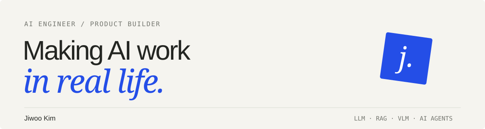

# Hi, I’m Jiwoo Kim.

**AI Engineer · LLM / RAG / VLM / AI Agents**

I build AI services that connect models to real workflows — from data and experimentation to system design, product delivery, and QA.

Currently an **AI Researcher at YSMeta**, previously at **Infofla** and **maum.ai**. I’m open to **full-time opportunities in Korea and Atlanta, Georgia**, as well as AI development and training collaborations.

[Portfolio →](https://jiwoo-kim-ai-portfolio.modestloach67.chatgpt.site/?lang=en) · [한국어 포트폴리오 →](https://jiwoo-kim-ai-portfolio.modestloach67.chatgpt.site/) · [Email →](mailto:jinnyfruit0527@gmail.com)

## What I work on

- **LLM & RAG systems:** retrieval, prompt engineering, data augmentation, and agent architecture.
- **Multimodal AI:** Qwen2.5-VL fine-tuning, task-specific data, UI action prediction, and model evaluation.
- **AI product delivery:** requirements, technical planning, QA, release management, and model/API evaluation.
- **Technical education:** hands-on AI workshops and mentoring that help people build working projects.

## Selected industry work

| Project | My contribution | Reported outcome |
| --- | --- | --- |
| [SELTO](https://jiwoo-kim-ai-portfolio.modestloach67.chatgpt.site/?lang=en#project/selto) | VLM prompts for screen-based automation and coordinate reasoning | System accuracy **60% → 85%** |
| [Amorepacific AI Chatbot](https://jiwoo-kim-ai-portfolio.modestloach67.chatgpt.site/?lang=en#project/amore) | PMO, technical design, RAG optimization, and QA | Chatbot accuracy **98%** |
| [ITOMS](https://jiwoo-kim-ai-portfolio.modestloach67.chatgpt.site/?lang=en#project/itoms) | SARIMA forecasting and CPU parallel processing | **4×** execution speed improvement |
| [PROMMI](https://jiwoo-kim-ai-portfolio.modestloach67.chatgpt.site/?lang=en#project/prommi) | Generative AI marketplace planning, model/API evaluation, content, QA, and release | Product delivery and ongoing iteration |

These are professional project outcomes reported in my résumé, measured in their respective project contexts. The portfolio explains my role in each.

## Explore the code

| Repository | What you’ll find |
| --- | --- |
| [ai_live · RESONA](https://github.com/jinnyfruit/ai_live) | A browser proof of concept for following a live singer’s musical position and controlling chorus timing. |
| [RAG](https://github.com/jinnyfruit/RAG) | Python experiments with retrieval-augmented generation and LangChain. |
| [Openeyes](https://github.com/jinnyfruit/Openeyes) | Backend, OCR, and summarization code for an accessibility project for people with low vision. |
| [digital-culture-center](https://github.com/jinnyfruit/digital-culture-center) | A Streamlit project with voice interaction and content generation. |

## Toolkit

**Models & data** — Python, PyTorch, NumPy, Pandas, scikit-learn, Qwen2.5-VL, LLaMA-Factory, MLflow  
**Services** — FastAPI, LLM APIs, RAG, prompt engineering, SQL / SQLite  
**Delivery** — System design, PL / PMO, QA, Jira, Confluence, technical documentation

## Beyond development

- **Technical mentor**, KAIST CT AI Content Microdegree · 2026
- **Lead instructor**, 20-session AI education course · 2026
- Enterprise AI education and mentoring with **Hyundai E&C, S-1, and Dongwon Group** · 2026
- **Top Excellence Award**, Yongin SW/AI Hackathon · 2023
- **B.S. in AI Software**, Gachon University · 2024
- **OPIc IH** · 2026 / Development internship in **Irvine, California**

<strong>한국어 소개</strong>

### 모델에서 실제 서비스까지 연결하는 AI 개발자, 김지우입니다.

LLM·RAG 기반 챗봇과 AI Agent, VLM 학습·자동화 서비스를 개발해 왔습니다. 데이터를 설계하고 모델을 개선하는 일뿐 아니라, 요구사항을 정리하고 QA와 출시까지 이어가는 일을 경험했습니다.

와이에스메타에서 AI 연구원으로 재직 중이며, 이전에는 인포플라와 마음에이아이에서 일했습니다. **한국·미국 애틀랜타의 풀타임 포지션**에 관심이 있고, AI 개발 협업과 기업교육도 함께합니다.

프로젝트에서 제가 맡은 일과 결과는 [포트폴리오](https://jiwoo-kim-ai-portfolio.modestloach67.chatgpt.site/)에서 자세히 보실 수 있습니다.

---

**Let’s build something useful.**  
[jinnyfruit0527@gmail.com](mailto:jinnyfruit0527@gmail.com)
